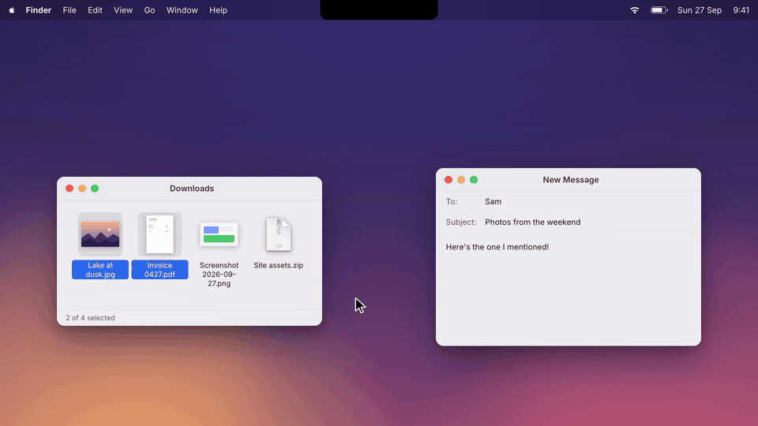
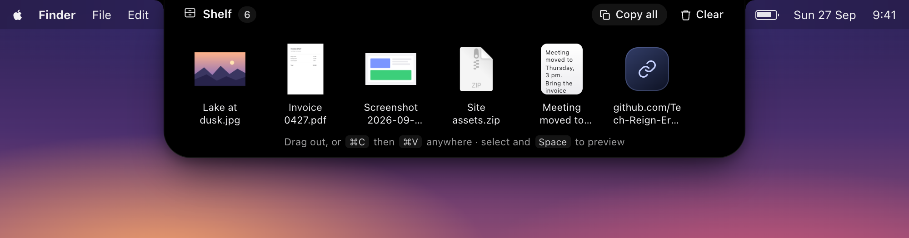
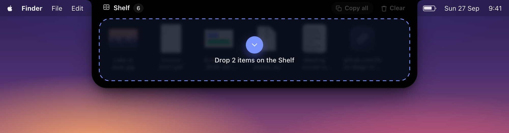
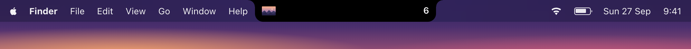
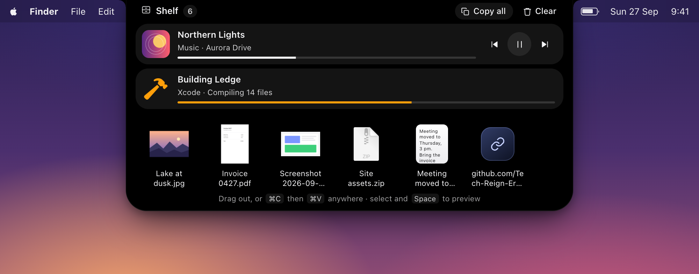
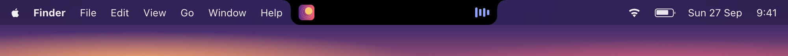
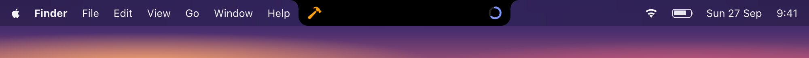
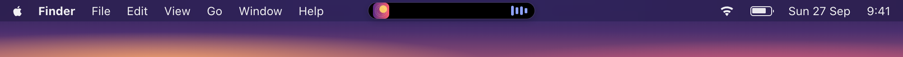

# Ledge

A Shelf in your Mac's notch. Keep files, text and links there for a moment, then drop them where they need to go —
and a todo list beside them, so what you have to do is where you're already looking.

**[tech-reign-era-services.github.io/ledge](https://tech-reign-era-services.github.io/ledge/)**



<sub>20 seconds, no sound. [Watch it in full quality (MP4)](docs/demo.mp4).</sub>

- **Hover** over the notch to peek, **drag** anything toward it to drop it in, or press **⌃⌥S** to open it.
- Drag items out to Finder, Mail, Slack or a browser upload box. Or select them, press **⌘C**, and **⌘V** anywhere.
- **Text with pictures:** copy from Notes, Mail, TextEdit, Pages or Safari, then **⌘V** in the Shelf. The text becomes notes and each picture becomes an image file, in order. Remote desktops like AnyDesk pass files but not pictures inside text, so copy the pictures from the Shelf (**⌘C**) and paste them on the other computer.
- **Space** opens Quick Look, just like in Finder. **⌘V** in the Shelf adds whatever is on the clipboard.
- **Todos:** press **⌘T** (or the checklist button) and type what you have to do, or press **⌃⌥T** and *say* it.
  Click a circle to tick it off. Closed,
  the island shows a green tick and how many are still waiting. Or **ask Siri** — see [Todos, and asking Siri](#todos-and-asking-siri).
- **Quick notes:** click the notch and start typing. **⏎** keeps the note on the Shelf (**⇧⏎** for a new line, **Esc** to cancel); drag it out, **⌘C** it, or **×** it away when you're done.
- Files are kept by reference: never copied, never moved. On a Mac without a notch, the Shelf sits in the middle of the menu bar.



Drag something toward the notch and the Shelf opens to take it. Closed, it shows the newest item and how many there are:




**Live activities**, like the Dynamic Island on iPhone:

- **Music:** while Apple Music or Spotify plays, the island shows the album artwork and bars that move to the music itself: bass to treble, from the player's own audio (macOS 14.2 or later; macOS asks once for System Audio Recording, and nothing is recorded or saved). Hover over the island for the song, a progress bar, and play, pause and skip.
- **Other apps** can show what they're doing, like a build, an upload or a timer, with a title, a symbol or emoji, progress, and a few characters beside the island. See [Show your app in the island](#show-your-app-in-the-island).
- **Updates from the app:** Ledge checks GitHub for a new release once a day (turn it off in Settings), or choose **Check for Updates…** in the menu bar icon. A new version shows in the island: click it, and Ledge downloads the installer, checks it against GitHub's SHA-256 digest, and opens it. What's on your Shelf is kept.
- **Settings…** in the menu bar icon (or ⌘,, or `open ledge://settings`): make the pill wider, taller or lower, the open island wider, open on hover or only on a click, and choose the music bars' colour. Changes show on the pill as you make them.
- **No notch? No problem.** On an external display, or any Mac without a notch, the island is a floating pill in the middle of the menu bar that appears when something is live or on the Shelf, and grows out of itself when you hover.



Closed, the island shows what's live beside the notch: the album artwork and bars that move to the music, or an app's symbol and its progress. Without a notch, the same thing sits in a pill:





The Shelf used to be part of [Inlet](https://github.com/Tech-Reign-Era-Services/inlet). The first time Ledge runs, it brings over anything that was on Inlet's Shelf.

## Download

Get **`Ledge-<version>.pkg`** (or the `.zip`) from [**Releases**](https://github.com/Tech-Reign-Era-Services/ledge/releases/latest). One download for every Mac, Apple silicon and Intel alike, under 1 MB. Needs macOS 13 Ventura or later.

The first time, macOS may say it can't verify it: Ledge isn't signed with a paid Apple certificate. **Right-click** it → **Open** → **Open**.

## Todos, and asking Siri

The Shelf holds what you're carrying; the list under it holds what you have to do.

In the island, press **⌘T** (or click the checklist button beside the pen) and type. **⏎** puts it on the list and
leaves the box open, so you can rattle off several; **Esc** stops. Each todo is a line with a circle — click it to tick
it off and it drops below the ones still waiting, struck through, until you **×** it away or choose **Clear Ticked Off**
from the menu bar icon. Closed, the island shows a green tick and how many are still to do, beside the Shelf's count.

**Say it, without Siri.** Press **⌃⌥T** anywhere, or click the microphone in the island, and talk. The island
opens, four bars move with your voice, the words appear as you say them, and when you stop talking it goes on the
list. **Esc** cancels, and closing the island stops it listening.

This uses the recogniser built into macOS, **on your Mac**: nothing you say is sent anywhere, nothing is recorded or
saved, and there is no model to download — which is why Ledge is still about 1.4 MB. If your Mac can't recognise
speech without sending it to Apple, Ledge says so and stops rather than doing it quietly. macOS asks once for the
microphone and once for speech recognition.

**Siri.** Ledge's actions are App Intents, so Siri, Shortcuts and Spotlight all know them:

| Say | What happens |
|---|---|
| "Ledge todo" | Siri asks what to add, then puts it on the list. |
| "Ledge todos" | Siri reads back what's still to do. |
| "Ledge tick off" | Siri asks which one, and marks the first that matches. |
| "Open Ledge" | The island opens. |

Each phrase leads with the app's name on purpose: "Add a todo to Ledge" is so close to how you add a reminder
to a list that Siri hands it to Reminders instead. Siri starts Ledge in the background if it isn't running, so a
todo lands on the list either way. The same four actions
appear in **Shortcuts** under Ledge, to use in shortcuts of your own.

**If Siri doesn't answer to those phrases yet,** macOS hasn't picked them up — it often takes a restart after
Ledge is first installed. A shortcut of your own works straight away, because Siri runs any shortcut by its name:
choose **Set Up Siri…** from the menu bar icon (or `open "ledge://siri"`) and it shows the three steps and opens
Shortcuts. In short: new shortcut, add Ledge's **Add a Todo** action, name it **Add Todo**. Then say
"Hey Siri, Add Todo".

Ledge can't add that shortcut for you: macOS refuses to import a shortcut file an app writes itself
("Importing unsigned shortcut files is not supported"), and signing one needs Apple's own service.

**From a script,** or anything that can open a URL:

```sh
open -g "ledge://todo?text=Buy%20milk%20on%20the%20way%20home"   # add one
open -g "ledge://todo/done?text=milk"                            # tick off the first one that matches
```

Asking for something already on the list doesn't add it twice: one still waiting is left alone, and one already ticked
off comes back to do. Todos are kept in `todos.json` beside `shelf.json`, and never leave your Mac.

> The Siri and Shortcuts actions need Ledge to have been built with full Xcode, which the released `.pkg` and `.zip`
> are. A build you make yourself with only the Command Line Tools has the todo list, the keyboard and `ledge://todo`,
> but nothing for Siri to find — see [Build](#build).

## Show your app in the island

Any app or script can start, update and end a live activity. There's no SDK: open a URL, or post a notification.

```sh
# Start (or update) an activity. Only id and title are needed to start one.
open -g "ledge://activity?id=build&title=Building&subtitle=Compiling%2014%20files&symbol=hammer.fill&progress=0.4&source=Xcode"

# Update it: only what changed.
open -g "ledge://activity?id=build&progress=0.9"

# End it.
open -g "ledge://activity/end?id=build"
```

From Swift (or anything that can post a distributed notification), without opening a URL. The object is a JSON string,
because sandboxed apps can't send `userInfo`:

```swift
DistributedNotificationCenter.default().postNotificationName(
    .init("com.techreignera.ledge.activity"),
    object: #"{"id":"upload","title":"Uploading photos","symbol":"arrow.up.circle.fill","progress":0.3}"#,
    userInfo: nil, deliverImmediately: true)
// …and {"id":"upload","action":"end"} when it's done.
```

| Field | What it does |
|---|---|
| `id` | Required. Letters, digits, `.`, `_` and `-`. The same id updates the same activity. |
| `title` | Required to start. Up to 60 characters. |
| `subtitle` | A second line, up to 80 characters. |
| `source` | Who it's from, shown small (e.g. your app's name). |
| `symbol` | An [SF Symbol](https://developer.apple.com/sf-symbols/) name, e.g. `timer`. Or `emoji`: one emoji. Or `bundle`: an app's bundle id, to show its icon. |
| `progress` | 0 to 1. A ring beside the closed island, and a bar when it's open. |
| `trailing` | Up to 8 characters beside the closed island, e.g. `4:59` or `80%`. |
| `tint` | A colour like `#ff9f0a` for the symbol, ring and bar. |
| `link` | Opened when someone clicks the activity: a web page or your app's own URL scheme (never `file:`). |
| `ttl` | Seconds until it goes away by itself. Default 10 minutes, at most a day. |

Everything is treated as untrusted: text is shown as text, never as markup, and at most four app activities show at once.

## Why it's so small

Ledge is about 1.1 MB. Inlet's Electron build is 217 MB. The island is still the same HTML, CSS and JavaScript,
so the design and animations haven't changed, but it runs in the WebKit that ships with macOS instead of a bundled
Chromium. Everything else (the window over the notch, dragging, Quick Look, the clipboard, the shortcut) is a few
hundred lines of Swift, with no dependencies.

| | Inlet's Shelf (Electron) | Ledge |
|---|---|---|
| App size | 217 MB (the whole of Inlet) | 1.1 MB |
| Download | 217 MB `.pkg` | ~620 KB `.zip` or `.pkg` |
| Drag detection | a long-running `osascript` | a system mouse event, then a 50 ms check only while the button is down |

## Build

You need the Xcode Command Line Tools (`xcode-select --install`), not Xcode itself.

```sh
./build.sh          # dist/Ledge.app, universal (Apple silicon + Intel)
./build.sh run      # build and open it
./build.sh test     # run the tests
./build.sh dist     # also dist/Ledge-<version>.zip and .pkg, then checks the size budget
```

Requires macOS 13 or later.

One part does need full Xcode: the Siri, Shortcuts and Spotlight actions are built from the compiler's const values by
`appintentsmetadataprocessor`, which only Xcode ships. With just the Command Line Tools the build says so and leaves
that bundle out — everything else, the todo list included, is built exactly the same. Releases are built on GitHub's
macOS runners, which have Xcode, so the downloads always have the Siri actions.

## Layout

```
Sources/
  App.swift         menu bar item, shortcut, Open at Login, ledge:// URLs, moving over from Inlet
  Activities.swift  live activities: what's accepted from other apps, music, the list (no AppKit, tested)
  TodoStore.swift   the todo list and todos.json (no AppKit, tested)
  Intents.swift     the Siri, Shortcuts and Spotlight actions (App Intents)
  Listen.swift      saying a todo: the microphone and macOS's on-device recogniser
  LiveActivities.swift  listening for music and other apps, player controls, icons
  Island.swift      the panel over the notch, its states and sizes, and the page's bridge
  Native.swift      drag detection, the global shortcut, thumbnails, clipboard, Quick Look
  Layout.swift      where the island sits for each state (no AppKit, tested)
  ShelfStore.swift  the items and shelf.json (no AppKit, tested)
  Updates.swift     what counts as a newer release on GitHub (no AppKit, tested)
  Updater.swift     checking for updates, downloading and checking the installer, opening it
web/                the island itself: shelf.html, shelf.css, shelf.js (from Inlet), bridge.js
tests/main.swift    tests for Layout, ShelfStore, TodoStore, Activities and Updates
scripts/            the icon, the installer's pre/postinstall scripts, and the App Intents protocol list
docs/               the demo video and screenshots in this README (not part of the app)
site/               the web page, published to GitHub Pages by .github/workflows/pages.yml
```

Items are saved in `~/Library/Application Support/Ledge/shelf.json`, todos in `todos.json`, and pasted pictures in
`Clips/` beside them.

For development, `LEDGE_DATA_DIR=/tmp/ledge-dev` keeps a dev build's Shelf apart from your real one, `LEDGE_DEBUG=1` logs state changes, `LEDGE_NO_NOTCH=1` behaves as on a screen without a notch, and `LEDGE_SNAPSHOT=out.png LEDGE_STATE=open` draws the island
to a PNG and quits. See [CONTRIBUTING.md](CONTRIBUTING.md) to help out.

## Releasing (maintainers)

1. Bump `VERSION` and add an entry to the top of `CHANGELOG.md`.
2. Commit, then tag and push: `git tag v1.1.0 && git push origin v1.1.0`.
3. The **Release** GitHub Action runs the tests, builds the universal app, `.zip` and `.pkg`, checks the size budget, and
   attaches them to a draft release using `.github/release-notes.md`. Add the version's changelog to the draft, then publish it.

## License

[MIT](LICENSE). Made by Tech Reign Era Services.
